


<a href="#identity"><code>01 identity</code></a> &nbsp;
<a href="#skills"><code>02 skills</code></a> &nbsp;
<a href="#projects"><code>03 projects</code></a> &nbsp;
<a href="#route"><code>04 route</code></a> &nbsp;
<a href="#telemetry"><code>05 telemetry</code></a> &nbsp;
<a href="#connect"><code>06 connect</code></a>


I'm **Mohamed**, a networking student in Morocco with a strong passion for **cybersecurity**. I'm building my foundations in how data moves, how networks are designed and how they are protected. After this year I'm moving into security, because I believe you can only defend a network you truly understand.

This profile is my learning log: I document my labs, notes and projects here as I grow.



 



<b>Plain-text skill list</b>

 

| Level | Skills |
|---|---|
| **Lab-proven** (in my public labs) | Cisco Packet Tracer, Cisco IOS, VLANs, 802.1Q trunks, inter-VLAN routing, OSPF multi-area, HSRP, EtherChannel (LACP), PortFast and BPDU Guard, ACLs, NAT, DHCP and relay, port security, SSH |
| **Studying** | CCNA 200-301 topics, TCP/IP and subnetting, network infrastructure, Linux administration, Kali Linux, Wireshark, Nmap, network security, cybersecurity fundamentals, GNS3 |
| **On the roadmap** | pfSense, Active Directory, Windows Server, Python automation, Bash, TryHackMe, HackTheBox |

 


<a href="https://github.com/mohamed-bensakar/CCNA-Project-01"></a>

<a href="https://github.com/mohamed-bensakar/CCNA-Project-02"></a>

<a href="https://github.com/mohamed-bensakar/OSPF-Multi-Zone"></a>

Each repository includes the <code>.pkt</code> file, a topology diagram, device configs and a verification guide.

 



### Goals

- [ ] Finish my networking studies and document every lab
- [ ] Build the home lab: pfSense, Kali and Active Directory
- [ ] Practice on TryHackMe and HackTheBox
- [ ] Learn Python to automate network and security tasks
- [ ] Get my first role in cybersecurity

<b>Open the home lab blueprint (planned)</b>

 


 



 


<!-- Discord: remove these comment markers and put your Discord user ID in the link

-->


