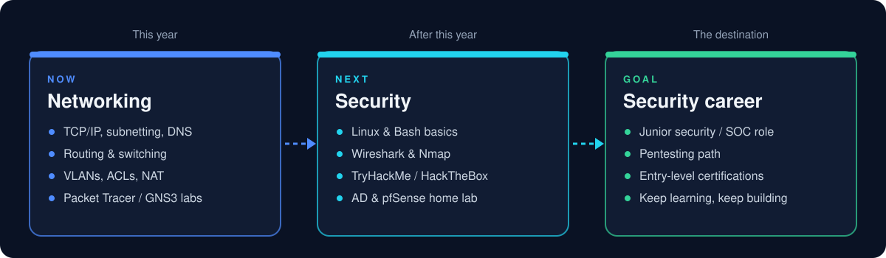
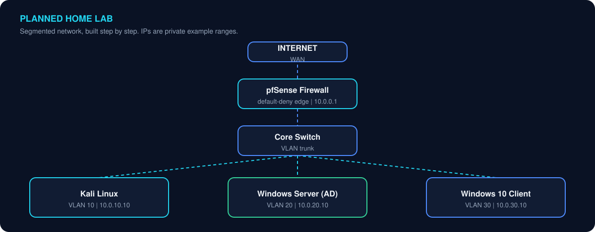

## 👋 About me

I'm **Mohamed**, a networking student with a strong passion for **cybersecurity**.

Right now I'm building my foundations in networking: how data moves, how networks are designed, and how they are protected. After this year, I'm moving into security, because I believe you can only defend a network you truly understand.

This profile is my learning log. I document my labs, notes and projects here as I grow.

## 📍 Right now

| | |
| --- | --- |
| 📚 **Studying** | Networking fundamentals |
| 🔭 **Next up** | Cybersecurity, starting after this year |
| 🧪 **Building** | A home lab with pfSense, Kali and Active Directory |
| 💬 **Ask me about** | Subnetting, VLANs and how packets travel |

## 🗺️ My journey

## 📦 A packet's journey

## 🧰 Skills & tools

| 🌐 Networking (studying now) | 🔐 Security (learning next) |
| --- | --- |
| TCP/IP and subnetting | Linux and Bash |
| Routing and switching | Wireshark and Nmap |
| VLANs, ACLs and NAT | TryHackMe and HackTheBox |
| Packet Tracer and GNS3 | Active Directory and pfSense labs |

## 🧪 My home lab

## 🎯 Goals

- [ ] Finish my networking studies and document every lab
- [ ] Build the home lab: pfSense, Kali and Active Directory
- [ ] Practice on TryHackMe and HackTheBox
- [ ] Learn Python to automate network and security tasks
- [ ] Get my first role in cybersecurity

## 📂 Projects

| Project | Description |
| --- | --- |
| [**network-labs**](https://github.com/mohamed-bensakar/network-labs) | Networking labs with topologies, configs and notes |
| [**homelab**](https://github.com/mohamed-bensakar/homelab) | Security home lab with pfSense, Kali and Active Directory |
| [**cheatsheets**](https://github.com/mohamed-bensakar/cheatsheets) | Quick references for networking, Linux and security tools |

## 🐍 Activity

## 📬 Let's connect

<!-- Discord: remove these comment markers and put your Discord user ID in the link

-->

*Understand the network first. Then learn how to defend it.*

